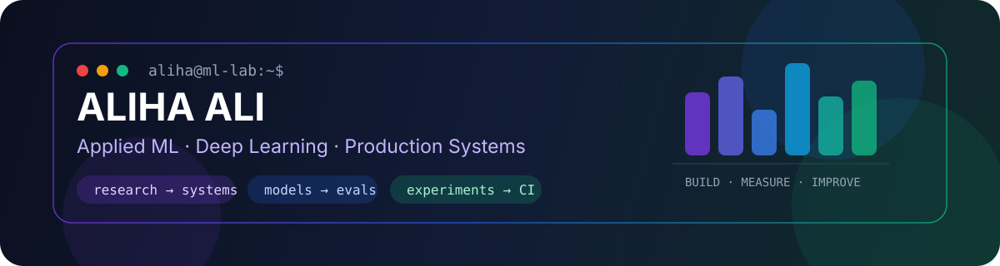

<p align="center">
  
</p>

<table>
<tr>
<td width="72%">

## Hi, I'm Aliha 👋

I'm a software engineer and MSc student focused on **applied machine learning, deep learning, and production ML systems**.

I like problems where model quality and software quality matter at the same time: building reliable pipelines, training and evaluating models, debugging experiments, and turning research ideas into systems people can actually use.

```text
$ whoami
Aliha Ali
Applied ML + software engineering
Toronto, Canada

$ current_focus
semi-supervised learning
computer vision robustness
LLM evaluation
production ML systems
```

</td>
<td width="28%" align="center">

### Currently building

`computer vision`  
`ML evaluation`  
`LLM systems`  
`production ML`

<br/>

[](https://www.linkedin.com/in/aliha-ali-b769a626a)

[](https://alihaapril.wixsite.com/aliha-ali)

</td>
</tr>
</table>

---

## 🧪 Research lab

| Area | What I'm exploring |
|---|---|
| **Computer Vision** | semi-supervised learning, robustness, medical imaging |
| **Applied ML** | tabular learning, feature engineering, evaluation |
| **LLM Systems** | evals, grounded generation, AI-assisted workflows |
| **ML Engineering** | reproducibility, testing, CI, inference-oriented tooling |

### Current build loop

```text
idea
  ↓
prototype
  ↓
measure
  ↓
debug
  ↓
evaluate
  ↓
ship
  ↺
```

---

## 🚀 Featured builds

<table>
<tr>
<td width="50%" valign="top">

### 🧠 [Deepfake Compression Robustness Study](https://github.com/aliha123/deepfake-compression-thesis)

Research tooling for measuring how lossy compression changes deepfake-detection workflows.

**Built with:** Python · PyTorch · OpenCV · scikit-learn · GitHub Actions

**Includes**
- JPEG/WebP perturbation utilities
- ROC AUC, F1, accuracy evaluation
- compression-level experiment CLI
- automated tests and CI

</td>
<td width="50%" valign="top">

### 🎓 [Student Retention ML](./projects/student-retention-ml)

End-to-end tabular ML pipeline for retention-risk prediction using reproducible synthetic data.

**Built with:** Python · pandas · scikit-learn · NumPy

**Includes**
- mixed-feature preprocessing
- class-weighted Random Forest
- probability-based evaluation
- reproducibility tests

</td>
</tr>

<tr>
<td width="50%" valign="top">

### 👁️ [Vision Robustness Lab](./projects/vision-robustness-lab)

Model-agnostic tooling for testing how image perturbations affect computer-vision inputs.

**Built with:** Python · Pillow · NumPy

**Includes**
- blur, noise, brightness transforms
- deterministic perturbations
- pixel-distance metrics
- tests for reproducibility

</td>
<td width="50%" valign="top">

### 🤖 [LLM Evaluation Toolkit](./projects/llm-evaluation-toolkit)

Deterministic evaluation utilities for generated text and prompt experiments.

**Built with:** Python

**Includes**
- exact match + token F1
- keyword coverage
- unsupported-number checks
- batch evaluation metrics

</td>
</tr>
</table>

---

## 🛠️ Stack

<p>
  
  
  
  
  
  
  
  
  
  
  
  
</p>

---

## 📊 GitHub signal

<p align="center">
  
  
</p>

<p align="center">
  
</p>

### 🐍 Contribution snake

<p align="center">
  <picture>
    <source media="(prefers-color-scheme: dark)" srcset="https://raw.githubusercontent.com/aliha123/aliha123/output/github-contribution-grid-snake-dark.svg" />
    <source media="(prefers-color-scheme: light)" srcset="https://raw.githubusercontent.com/aliha123/aliha123/output/github-contribution-grid-snake.svg" />
    
  </picture>
</p>

---

## 📓 Build log

```text
2026-11  → rebuilt GitHub around applied ML + research
2026-11  → added deepfake compression robustness tooling
2026-11  → added tabular ML retention pipeline
2026-11  → added computer vision robustness lab
2026-11  → added LLM evaluation toolkit
2026-11  → added CI + automated testing
```

---

## 🔬 Research interests

**Computer vision** · **semi-supervised learning** · **robust ML** · **model evaluation** · **applied generative AI** · **ML systems**

> I care less about making a demo look intelligent and more about understanding when a model works, when it fails, and how to build the surrounding system so those failures are measurable.

---

<p align="center">
  <b>build → measure → learn → improve</b>
</p>
